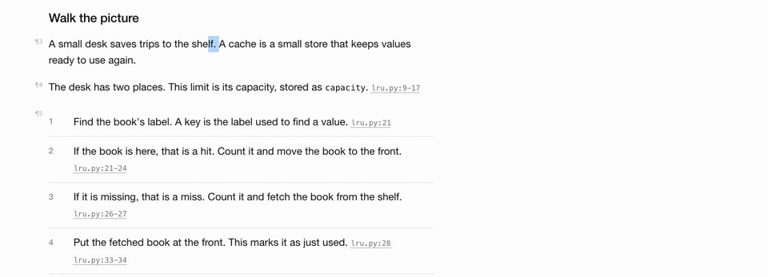
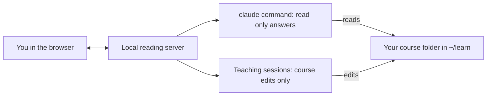

<div align="center">
  <picture>
    <source media="(prefers-color-scheme: dark)" srcset="docs/images/banner-dark.png">
    
  </picture>
  <h1>visual-teach</h1>
  <p><strong>Learn any topic, or any codebase, as short visual lessons in your browser.<br>
  Highlight anything and Claude answers beside it.</strong></p>
  <p>
    <a href="LICENSE"></a>
    <a href="#install"></a>
    
    
    
  </p>
  
</div>

<a id="install"></a>

## Quick start

1. Install. In Claude Code, as a plugin that keeps itself up to date:

   ```text
   /plugin install visual-teach --marketplace drag88/visual-teach
   ```

   On Claude Code before 2.1.275, run `/plugin marketplace add drag88/visual-teach`, then `/plugin install visual-teach@visual-teach`. Then turn on updates once: open `/plugin`, go to Marketplaces, choose visual-teach and Enable auto-update. Claude Code keeps plugins from other marketplaces at the installed version until you do.

   For Codex, or Codex and Claude Code together:

   ```sh
   npx skills add drag88/visual-teach -g -a claude-code -a codex
   ```

   Update that copy with `npx skills update`. Keep one copy per computer: two copies both load, and each resets your courses to its own version.

2. Ask for a course in Claude Code:

   ```text
   /visual-teach how DNS works
   ```

   As a plugin it is also `/visual-teach:visual-teach`. Or in Codex:

   ```text
   $visual-teach how DNS works
   ```

3. Answer a few questions about why you want to learn it. Claude then writes the first lesson, which takes about 5 to 15 minutes, and opens it in your browser. Highlight anything to ask.

Requirements: Node.js for the npx install; Python 3.9 or later; Claude Code's `claude` command installed and signed in for live answers; Python Playwright only for the checks (it uses its own Chromium, or your installed Chrome). On Windows, type `python` or `py` wherever this page says `python3`.

## What you get

### Ask while reading

Answers appear beside the passage, with follow-ups in the same place. Choose Explain, Simpler, More or Connect, or write your own question.


### Read the real source

Source citations open the real file beside the lesson, with the cited lines marked. Highlight code to use Walk through or Where else.


### Quizzes that make you think

Quizzes ask you to tap a diagram, choose an answer, recall an idea or predict what code prints. Write first, then reveal; Check my answer asks Claude to mark your written answer.

<p align="center"></p>

### Teach from the page

The course home page can teach the next lesson or update lessons from your questions. You can follow a teaching session's progress and stop it on the course home page.


- Missed questions return for spaced review after 1, 3 and 7 days.
- Every page supports light and dark, including on a phone.
- A phone link with `--lan` works on the same Wi-Fi.
- A carry-over sheet collects rules that hold beyond one course.

## How it works



The local server connects your browser to the `claude` command. Courses live in `~/learn/`, outside your code repositories.

## Use it with your own code or notes

Add `--code <folder>` for a codebase or folder of notes. Citations then open the real files beside the lesson, with the cited lines marked.

To open an existing course to read, with no teaching session:

```text
/visual-teach open ~/learn/<course>
```

In Codex, `$visual-teach open ~/learn/<course>`. With an npx install you can also run the opener from your normal shell:

```sh
python3 ~/.agents/skills/visual-teach/scripts/open_course.py ~/learn/<course>
```

That is where `npx skills add -g` puts the skill. After a manual install, use:

```sh
python3 ~/code/visual-teach/scripts/open_course.py ~/learn/<course>
```

Opening a course brings its shared files up to date, and after an update restarts its reading server; if a teaching session is running, the restart waits for the next open. Add `--lan` for a phone on the same Wi-Fi, and `--no-lan` to turn it off; each restart gives the phone a new link. The `--code` and `--lan` settings are saved for that course. Add `--stop` to stop its server.

To continue a course in Claude Code:

```text
/visual-teach continue ~/learn/<course>
```

Or in Codex:

```text
$visual-teach continue ~/learn/<course>
```

## Costs

| Action | Model | Typical time |
|---|---|---|
| Quick answer | Sonnet | About 5 seconds to start |
| Deep answer | Opus | About 25 seconds |
| Teaching session | Opus | About 5 to 15 minutes |
| Reading and quizzes | None | Instant |

It runs on your own Claude plan. Reading and local quizzes need no live answers.

## Privacy and safety

- Course files, notes and saved answers stay on your computer. Live questions send context to Claude through your signed-in account, including any files it reads from the `--code` folder, as in any Claude Code session. Point `--code` at code or notes you are allowed to share with Claude, not at folders of customer or personal data. Lessons quote code, never data.
- The server listens on localhost by default. With `--lan`, it listens on your local network behind a token in the phone link. Keep that link private.
- Answers and teaching sessions run with `claude --restricted`: your own Claude settings, hooks and plugins stay out of them. Answers are read-only. Teaching sessions can edit course content, including lesson files, only inside the course folder.
- `scripts/teach_guard.py` enforces that boundary and protects settings and shared assets. Served course pages run only the skill's own scripts.
- Outside the course folder, the skill writes one file: its diagram style, as diagram-design's `learn` profile in `~/.diagram-design/profiles/learn.md`.

<details>
<summary>Install by hand</summary>

Clone the repo and link it into both agents' skill folders:

```sh
mkdir -p ~/code ~/.claude/skills ~/.agents/skills
git clone https://github.com/drag88/visual-teach.git ~/code/visual-teach
ln -s ~/code/visual-teach ~/.claude/skills/visual-teach
ln -s ~/code/visual-teach ~/.agents/skills/visual-teach
```

</details>

<details>
<summary>What is in this repo</summary>

| Path | What it is |
|---|---|
| `SKILL.md` | The instructions Claude Code and Codex follow. |
| `.claude-plugin/` | The Claude Code plugin and the marketplace that serves it. |
| `CHANGELOG.md` | What changed in each release. |
| `agents/openai.yaml` | Codex settings for calling the skill by name. |
| `starter/` | Page templates, shared styles and scripts, the answer prompt and the diagram profile. |
| `scripts/` | The reading server, course opener, asset sync, course checker, teaching edit guard and tests. |
| `vendor/` | The bundled teach method and diagram-design, with their licences and source records. |
| `docs/images/` | README screenshots of a demo course kept outside this repo. |
| `LICENSE` | The MIT licence for visual-teach. |

</details>

<details>
<summary>Develop</summary>

The tests use a fake Claude, so they cost nothing. The reader and quiz tests need Python Playwright with Chromium.

```sh
python3 scripts/test_serve.py
python3 scripts/test_open_course.py
python3 scripts/test_reader.py
python3 scripts/test_quiz.py
python3 scripts/test_release.py
```

After changing `starter/`, open each course again or run `python3 scripts/sync_course.py ~/learn/<course>`. Releases follow the steps at the end of `SKILL.md`: a version in `.claude-plugin/plugin.json`, a `CHANGELOG.md` entry, a `v<version>` tag and a GitHub release.

</details>

## Credits

The bundled [teach method by Matt Pocock](https://github.com/mattpocock/skills/tree/ad5400b930b297b0c0cb231ff1ffe42a7da666aa/skills/productivity/teach) and [diagram-design by Cathryn Lavery](https://github.com/cathrynlavery/diagram-design/tree/9874ad73813715fc36875e45afd9cd94c68f3c3f/skills/diagram-design) are both MIT licensed. Their pinned sources and notices are in [teach's UPSTREAM.md](vendor/teach/UPSTREAM.md) and [diagram-design's UPSTREAM.md](vendor/diagram-design/UPSTREAM.md).

## License

[MIT](LICENSE).
