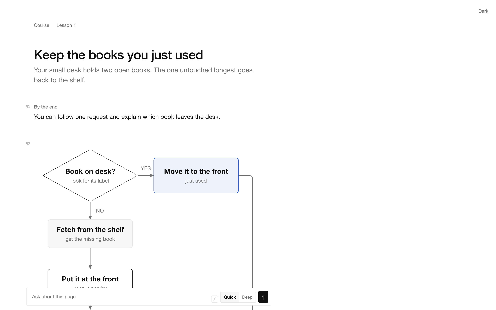
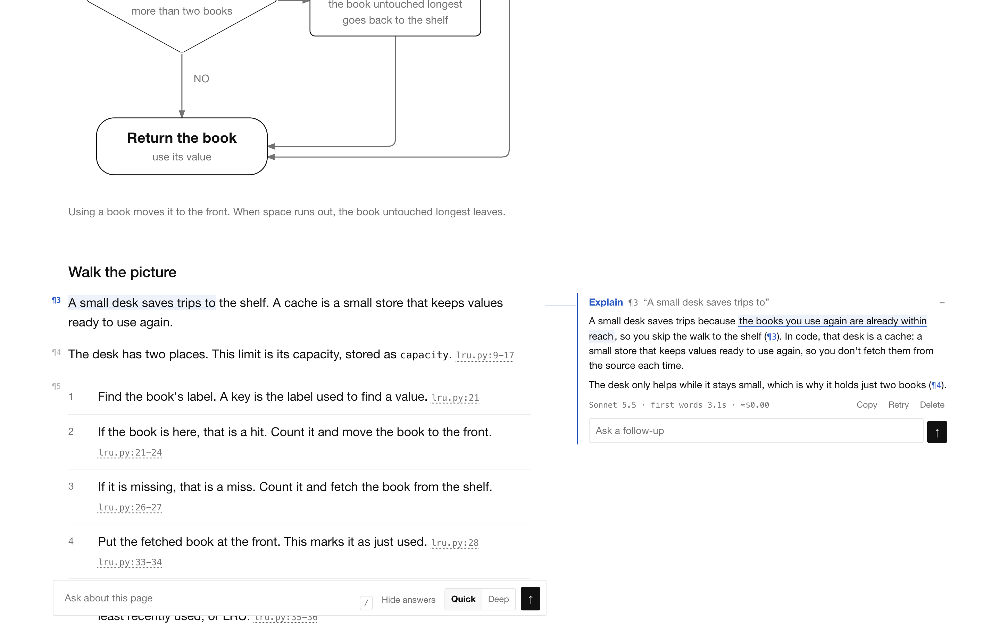
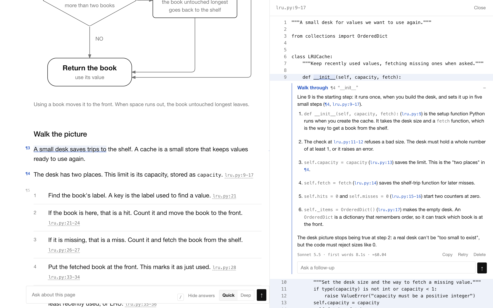
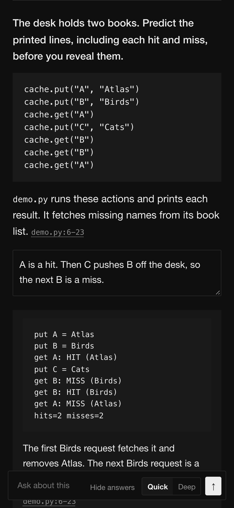
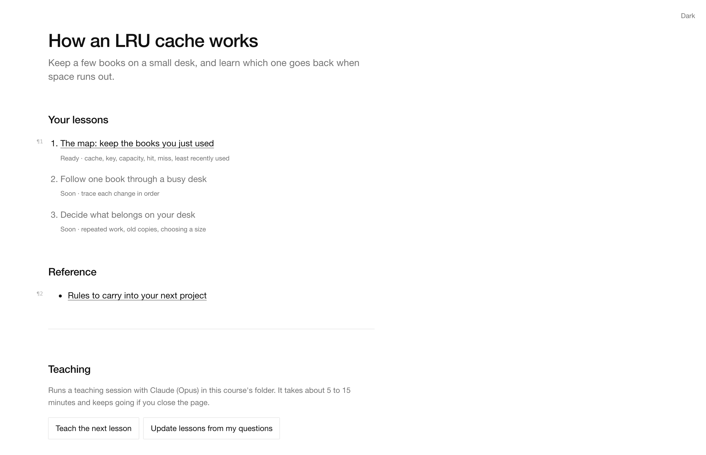

# visual-teach

Learn any topic, or any codebase, as short visual lessons in your browser, with Claude answering whatever you highlight.



## Install

```sh
npx skills add drag88/visual-teach -g -a claude-code -a codex
```

This installs the skill for both Claude Code and Codex.

You need Python 3.9 or later. For live answers, Claude Code's `claude` command must be installed and signed in. Python Playwright with Chromium is needed only for the checks.

To install manually, clone the repo and link it into both agents' skill folders:

```sh
mkdir -p ~/code ~/.claude/skills ~/.agents/skills
git clone https://github.com/drag88/visual-teach.git ~/code/visual-teach
ln -s ~/code/visual-teach ~/.claude/skills/visual-teach
ln -s ~/code/visual-teach ~/.agents/skills/visual-teach
```

## Use

In Claude Code:

```text
/visual-teach <topic>
/visual-teach continue ~/learn/<course>
```

In Codex:

```text
$visual-teach <topic>
$visual-teach continue ~/learn/<course>
```

Courses live in `~/learn/`, outside your code repositories. The skill opens the first lesson for you.

To open an existing course, run the skill's `open_course.py` from your normal shell:

```sh
python3 ~/.agents/skills/visual-teach/scripts/open_course.py ~/learn/<course>
```

That is where `npx skills add -g` puts the skill. After a manual install, use `~/code/visual-teach/scripts/open_course.py`.

Add `--code <folder>` for a codebase or folder of notes. Add `--lan` for a phone on the same Wi-Fi. These settings are saved for that course. Add `--stop` to stop its server.

## What you get

Highlight a passage and ask about it. Choose Explain, Simpler, More or Connect, or write your own question. Answers appear beside the passage, with follow-ups in the same place.



Source citations open the real file beside the lesson, with the cited lines marked. Highlight code to use Walk through or Where else.



Quizzes ask you to tap a diagram, choose an answer, recall an idea or predict what code prints. Write first, then reveal. Check my answer asks Claude to mark your written answer.



The course home page can teach the next lesson or update lessons from your questions. You can follow its progress and stop the session there.



Missed questions return for spaced review after 1, 3 and 7 days. Every page supports light and dark, including on a phone.

## Costs

Answers run on your own Claude plan: Quick uses Sonnet, and Deep uses Opus. A teaching session runs Opus for about 5 to 15 minutes. Reading and local quizzes need no live answers.

## Privacy and safety

Course files, notes and saved answers stay on your computer. Live questions send context to Claude through your signed-in account.

The server listens on localhost by default. With `--lan`, it listens on your local network behind a token in the phone link. Keep that link private.

Answers are read-only. Teaching sessions can edit course content, including lesson files, only inside the course folder. `scripts/teach_guard.py` enforces that boundary and protects settings and shared assets. Served course pages run only the skill's own scripts.

## Credits

The bundled [teach method by Matt Pocock](https://github.com/mattpocock/skills/tree/ad5400b930b297b0c0cb231ff1ffe42a7da666aa/skills/productivity/teach) and [diagram-design by Cathryn Lavery](https://github.com/cathrynlavery/diagram-design/tree/9874ad73813715fc36875e45afd9cd94c68f3c3f/skills/diagram-design) are both MIT licensed. Their pinned sources and notices are in [teach's UPSTREAM.md](vendor/teach/UPSTREAM.md) and [diagram-design's UPSTREAM.md](vendor/diagram-design/UPSTREAM.md).

## Layout

| Path | What it is |
|---|---|
| `SKILL.md` | The instructions Claude Code and Codex follow. |
| `agents/openai.yaml` | Codex settings for calling the skill by name. |
| `starter/` | Page templates, shared styles and scripts, the answer prompt and the diagram profile. |
| `scripts/` | The reading server, course opener, asset sync, course checker, teaching edit guard and tests. |
| `vendor/` | The bundled teach method and diagram-design, with their licences and source records. |
| `docs/images/` | README screenshots of a demo course kept outside this repo. |
| `LICENSE` | The MIT licence for visual-teach. |

## Develop

The tests use a fake Claude, so they cost nothing. The reader and quiz tests need Python Playwright with Chromium.

```sh
python3 scripts/test_serve.py
python3 scripts/test_open_course.py
python3 scripts/test_reader.py
python3 scripts/test_quiz.py
```

After changing `starter/`, run `python3 scripts/sync_course.py ~/learn/<course>` for each course.

## License

[MIT](LICENSE).
