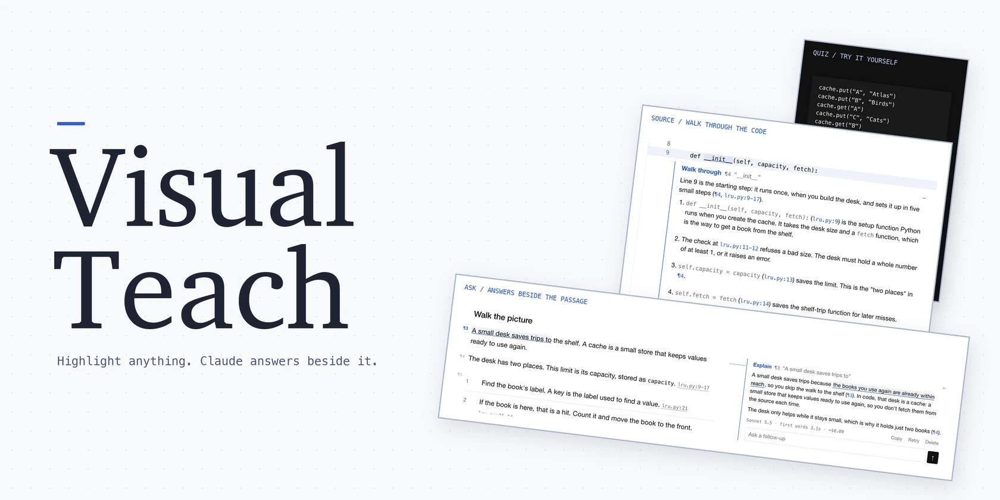
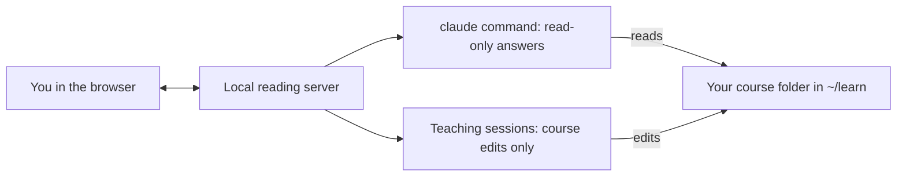

<div align="center">

<h1>
  <picture>
    <source media="(prefers-color-scheme: dark)" srcset="docs/hero/hero-dark.webp">
    
  </picture>
</h1>

**An agent skill that turns any topic, or any codebase, into a course of short visual lessons in your browser.<br>
Highlight a passage and Claude answers beside it. Quizzes, diagrams and spaced review included.**

[](https://github.com/drag88/visual-teach/stargazers)
[](https://skills.sh/drag88/visual-teach/visual-teach)
[](https://github.com/drag88/visual-teach/actions/workflows/ci.yml)
[](CHANGELOG.md)
[](LICENSE)

[Install](#install) · [What you get](#what-you-get) · [How it works](#how-it-works) · [Your own code](#use-it-with-your-own-code-or-notes) · [Costs](#costs) · [Privacy](#privacy-and-safety) · [Changelog](CHANGELOG.md)

<code>npx skills add drag88/visual-teach</code>

<br><br>


</div>

<br>

Ask your agent in plain words:

- `/visual-teach how DNS works`
- `/visual-teach how a request moves through ~/code/my-app`
- `/visual-teach Bayesian statistics, so I can read our A/B test reports`
- `/visual-teach continue ~/learn/dns`

It asks a few questions about why you want to learn it, then writes the first lesson in about 5 to 15 minutes and opens it in your browser. In Codex, type `$visual-teach` instead.

---

## Install

In Claude Code, as a plugin that keeps itself up to date:

```text
/plugin install visual-teach --marketplace drag88/visual-teach
```

For Codex, or Codex and Claude Code together, with the cross-agent [`skills` CLI](https://skills.sh):

```sh
npx skills add drag88/visual-teach -g -a claude-code -a codex
```

Keep one copy per computer: two copies both load, and each resets your courses to its own version.

<details>
<summary><b>Claude Code</b>: older versions and auto-update</summary>

On Claude Code before 2.1.275, run `/plugin marketplace add drag88/visual-teach`, then `/plugin install visual-teach@visual-teach`. As a plugin the command is also `/visual-teach:visual-teach`.

Turn on updates once: open `/plugin`, go to Marketplaces, choose visual-teach and Enable auto-update. Claude Code keeps plugins from other marketplaces at the installed version until you do.

</details>

<details>
<summary><b>npx skills</b>: what it installs and how to update</summary>

The CLI finds `skills/visual-teach/SKILL.md` and copies only that folder: the instructions, the reading server, the page templates and the bundled teach method and diagram-design. Update it with `npx skills update`.

</details>

**Requirements:** Python 3.9 or later; Claude Code's `claude` command installed and signed in, for live answers; Node.js for the npx install; Python Playwright only for the lesson checks (it uses its own Chromium, or your installed Chrome). On Windows, type `python` or `py` wherever this page says `python3`.

## What you get

### Ask while reading

Answers appear beside the passage, with follow-ups in the same place. Choose Explain, Simpler, More or Connect, or write your own question.


### Read the real source

Source citations open the real file beside the lesson, with the cited lines marked. Highlight code to use Walk through or Where else.


### Quizzes that make you think

Quizzes ask you to tap a diagram, choose an answer, recall an idea or predict what code prints. Write first, then reveal; Check my answer asks Claude to mark your written answer.

<p align="center"></p>

### Teach from the page

Teach, at the top right of every page, writes the next lesson or updates lessons from your questions. While a session runs, Teach shows how long it has been going, and its panel shows the current step and a Stop button.


- Missed questions return for spaced review after 1, 3 and 7 days.
- Every page supports light and dark, including on a phone.
- A phone link with `--lan` works on the same Wi-Fi.
- A carry-over sheet collects rules that hold beyond one course.
- A library page at `~/learn/index.html` lists every course, its rules and what you have shown you know.

## How it works



The local server connects your browser to the `claude` command. Courses live in `~/learn/`, outside your code repositories.

## Use it with your own code or notes

Add `--code <folder>` for a codebase or folder of notes. Citations then open the real files beside the lesson, with the cited lines marked.

To open an existing course to read, with no teaching session:

```text
/visual-teach open ~/learn/<course>
```

In Codex, `$visual-teach open ~/learn/<course>`. With an npx install you can also run the opener from your normal shell:

```sh
python3 ~/.agents/skills/visual-teach/scripts/open_course.py ~/learn/<course>
```

That is where `npx skills add -g` puts the skill. After a manual install, use:

```sh
python3 ~/code/visual-teach/skills/visual-teach/scripts/open_course.py ~/learn/<course>
```

Opening a course brings its shared files up to date, and after an update restarts its reading server; if a teaching session is running, the restart waits for the next open. Add `--lan` for a phone on the same Wi-Fi, and `--no-lan` to turn it off; each restart gives the phone a new link. The `--code` and `--lan` settings are saved for that course. Add `--stop` to stop its server.

To continue a course in Claude Code:

```text
/visual-teach continue ~/learn/<course>
```

Or in Codex:

```text
$visual-teach continue ~/learn/<course>
```

## Costs

| Action | Model | Typical time |
|---|---|---|
| Quick answer | Sonnet | About 5 seconds to start |
| Deep answer | Opus | About 25 seconds |
| Teaching session | Opus | About 5 to 15 minutes |
| Reading and quizzes | None | Instant |

It runs on your own Claude plan. Reading and local quizzes need no live answers.

## Privacy and safety

- Course files, notes and saved answers stay on your computer. Live questions send context to Claude through your signed-in account, including any files it reads from the `--code` folder, as in any Claude Code session. Point `--code` at code or notes you are allowed to share with Claude, not at folders of customer or personal data. Lessons quote code, never data.
- The server listens on localhost by default. With `--lan`, it listens on your local network behind a token in the phone link. Keep that link private.
- Answers and teaching sessions run with `claude --restricted`: your own Claude settings, hooks and plugins stay out of them. Answers are read-only. Teaching sessions can edit course content, including lesson files, only inside the course folder.
- `skills/visual-teach/scripts/teach_guard.py` enforces that boundary and protects settings and shared assets. Served course pages run only the skill's own scripts.
- Outside the course folder, the skill writes its diagram style, as diagram-design's `learn` profile in `~/.diagram-design/profiles/learn.md`, and the library page `~/learn/index.html` with its two style files in `~/learn/library-assets/`, rebuilt when a course in `~/learn` is opened.

<details>
<summary>Install by hand</summary>

Clone the repo and link it into both agents' skill folders:

```sh
mkdir -p ~/code ~/.claude/skills ~/.agents/skills
git clone https://github.com/drag88/visual-teach.git ~/code/visual-teach
ln -s ~/code/visual-teach/skills/visual-teach ~/.claude/skills/visual-teach
ln -s ~/code/visual-teach/skills/visual-teach ~/.agents/skills/visual-teach
```

</details>

<details>
<summary>What is in this repo</summary>

| Path | What it is |
|---|---|
| `skills/visual-teach/` | The skill itself. Installs copy only this folder. |
| `skills/visual-teach/SKILL.md` | The instructions Claude Code and Codex follow. |
| `skills/visual-teach/agents/openai.yaml` | Codex settings for calling the skill by name. |
| `skills/visual-teach/starter/` | Page templates, shared styles and scripts, the answer prompt and the diagram profile. |
| `skills/visual-teach/scripts/` | The reading server, course opener, asset sync, course checker, teaching edit guard and tests. |
| `skills/visual-teach/vendor/` | The bundled teach method and diagram-design, with their licences and source records. |
| `.claude-plugin/` | The Claude Code plugin and the marketplace that serves it. |
| `CHANGELOG.md` | What changed in each release. |
| `tests/` | The release check, which needs the repo around the skill. |
| `docs/images/` | README screenshots of a demo course kept outside this repo. |
| `LICENSE` | The MIT licence for visual-teach; the skill folder carries a copy. |

</details>

<details>
<summary>Develop</summary>

The tests use a fake Claude, so they cost nothing. The reader and quiz tests need Python Playwright with Chromium.

```sh
python3 skills/visual-teach/scripts/test_serve.py
python3 skills/visual-teach/scripts/test_open_course.py
python3 skills/visual-teach/scripts/test_reader.py
python3 skills/visual-teach/scripts/test_quiz.py
python3 tests/test_release.py
```

After changing `starter/`, open each course again or run `python3 skills/visual-teach/scripts/sync_course.py ~/learn/<course>`. Releases follow the steps at the end of `skills/visual-teach/SKILL.md`: a version in `.claude-plugin/plugin.json`, a `CHANGELOG.md` entry, a `v<version>` tag and a GitHub release.

</details>

## Credits

The bundled [teach method by Matt Pocock](https://github.com/mattpocock/skills/tree/ad5400b930b297b0c0cb231ff1ffe42a7da666aa/skills/productivity/teach) and [diagram-design by Cathryn Lavery](https://github.com/cathrynlavery/diagram-design/tree/9874ad73813715fc36875e45afd9cd94c68f3c3f/skills/diagram-design) are both MIT licensed. Their pinned sources and notices are in [teach's UPSTREAM.md](skills/visual-teach/vendor/teach/UPSTREAM.md) and [diagram-design's UPSTREAM.md](skills/visual-teach/vendor/diagram-design/UPSTREAM.md).

## License

[MIT](LICENSE).
