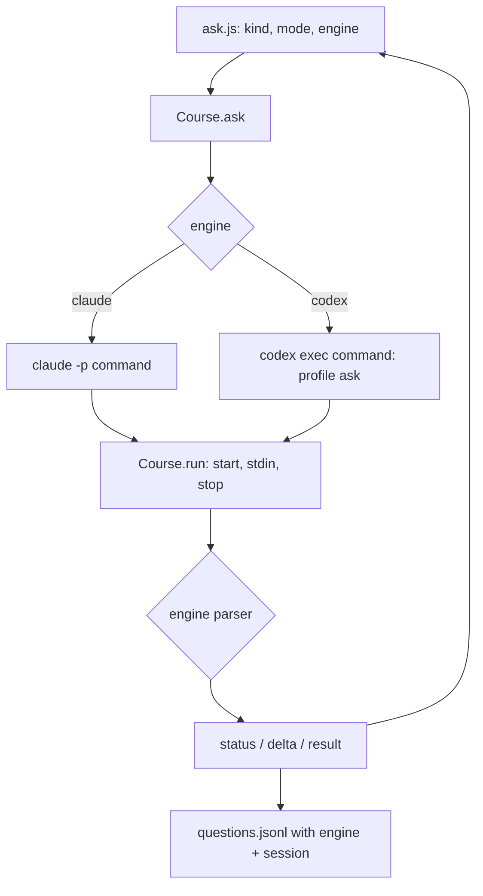
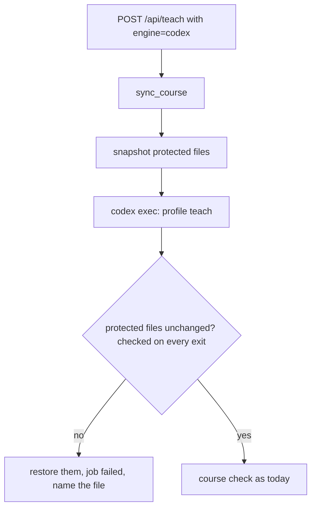
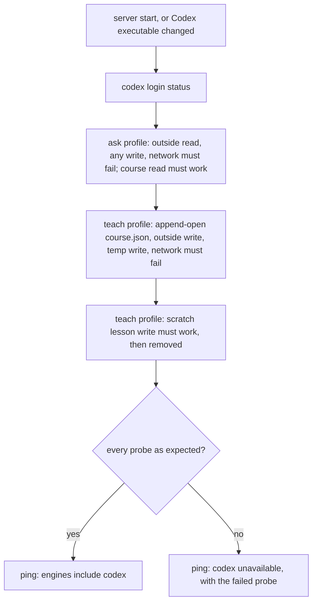

# Choose Claude or Codex for answers and teaching - Plan

---

## Goal Capsule

- **Objective:** a learner who has Codex installed can get answers, answer checks and Teach sessions from Codex instead of Claude, picked from the page, with the same limits on what it may read and edit that Claude has today.
- **Means:** a second engine in the reading server, driven through `codex exec` under two named Codex permission profiles, one for answers and one for Teach (KTD1, KTD2).
- **Authority:** this plan's Requirements, then its KTDs, then the units. The three session-settled Key Decisions in the Product Contract (switch in the page, Teach on Codex, Codex's sandboxed shell) are not reopened during the build.
- **Stop conditions:** stop and report if the Codex permission profiles cannot be shown to block a read outside the course and a write to a protected file on this Mac (U2 preflight). Stop and report if no Codex flag can be shown to keep a course's `.codex/` config and hooks from loading. Stop if the diff grows past about 1,200 lines.
- **Execution profile:** one build session, test-first for the server pieces, then one `ce-code-review` with the cross-model pass before release.
- **Who finishes:** the build agent implements and verifies. Aswin approves the commit, push and release.

---

## Product Contract

### Summary

The page's ask bar gets a Claude / Codex switch beside Quick / Deep. Answers, follow-ups, Check my answer and the three Teach actions run on whichever engine is picked. Codex runs under permission profiles that limit reads to the course and its source folder and writes to unprotected course files. The server proves those limits work before it offers Codex at all.

### Problem Frame

visual-teach builds courses from either Claude Code or Codex, but everything after the lesson opens runs only on Claude: `scripts/serve.py` finds `claude` on PATH and exits without it. A Codex-only learner gets lessons and no live answers, and a learner with both cannot choose. The safety model was built around Claude's tools: answers can only read the course and its `--code` folder, and Teach edits pass through `scripts/teach_guard.py`. Codex has neither Claude's tool allowlist nor a hook that can carry the guard as the boundary, so adding it means rebuilding those limits a different way, not just swapping a command.

### Requirements

**Choosing the engine**

- R1. When both `claude` and `codex` are available and Codex passed its preflight (R9), the ask bar shows a Claude / Codex switch next to Quick / Deep. The page remembers the choice the way it remembers Quick / Deep.
- R2. With only one engine available, the page shows no switch and everything runs on that engine.
- R3. Each course keeps a default engine in `course.json`, set with `open_course.py --engine claude|codex`. The page's remembered choice wins over it, but only when that engine is usable now.
- R15. The server runs only engines that passed R9. A request naming an unusable engine is refused with the reason, whatever the page, the course default or the remembered choice says.
- R4. The server starts when either engine is on PATH, and exits with a clear message only when neither is. When an engine is on PATH but none is usable (Codex alone, failing R9), the server still serves the course for reading, and the page shows why answers and Teach are unavailable.

**Answers on Codex**

- R5. Explain, Simpler, More, Connect, Ask, whole-page questions, Walk through, Where else and Check my answer all work on Codex, with the same prompts and the same logging to `questions.jsonl`.
- R6. A follow-up in a card continues the same engine session when the card's engine matches the current choice. When the learner switched engines, the follow-up starts a new session on the new engine and carries the thread so far in the prompt.
- R7. Codex answers can read only the course folder, its `--code` folder and the runtime paths Codex needs. They cannot write anywhere, cannot use the network, and have no web access even when the course has `--web` domains.
- R8. A Codex answer shows its model, time to the answer and token count. It shows no dollar figure, since Codex reports none.

**Safety**

- R9. Before offering Codex, the server checks that Codex is signed in and runs a token-free preflight under the same profiles: under the ask profile, a read of a decoy outside the course, any write and a network connection must fail, and a read inside must work; under the teach profile, a write to a protected course file, a write outside the course, a write to a temp folder and a network connection must fail, and a write to a lesson must work. No probe may change a real course file even if the sandbox wrongly allows it. Codex is offered only when all of these hold, and the page says why when it is not.
- R10. A Teach session on Codex may edit only the files a Claude Teach session may edit (the property `.claude/skills/verify-teach-guard` checks), may not use the network, and may not write to temp folders.
- R11. After every Codex Teach session, the server compares the protected course files (those in R10, plus `.codex/`) with their state before the session. Any change is reverted, the job fails, and the page says which file was touched.
- R12. Codex runs never load the learner's own Codex config, rules, hooks, MCP servers, memories or `AGENTS.md`, nor any Codex config inside the course folder.

**Teach on Codex**

- R13. Teach the next lesson, Update lessons from my questions and Fix the check problems run on the engine picked in the page, show their steps in the Teach panel as today, and run the course check afterwards.
- R14. Stop ends a Codex run and everything it started, as it does for Claude.

### Key Decisions

- **Switch in the page, plus a course default.** Governs R1, R3. (session-settled: user-directed — chosen over choosing once per course with no switch: the learner wants to compare engines while reading.)
- **Teach runs on Codex too, not only answers.** Governs R10, R11, R13, R14. (session-settled: user-directed — chosen over answers only: one engine choice should cover everything the page does.)
- **Codex uses its shell, inside the sandbox.** Governs R7, R10. (session-settled: user-directed — chosen over a server-side file bridge that keeps Codex shell-free: the sandbox enforces the same boundary at the OS level for a fraction of the work.)

### Scope Boundaries

- Web access for Codex answers. Codex's hosted web search is not governed by the profile's network rules, so it cannot be held to the course's `--web` domains.
- Word-by-word streaming for Codex. `codex exec --json` delivers each answer whole.
- Engines other than Claude and Codex.

#### Deferred to Follow-Up Work

- The macOS CI failure in `test_open_course.py` (the opener subprocess times out after 30 s on GitHub's macOS runners only).
- Tuning Quick and Deep effort for Codex after real answers have been read (KTD6).
- Codex on Windows and Linux: the preflight (R9) decides at runtime, but neither was tried during planning.

### Sources

- Codex non-interactive mode: https://learn.chatgpt.com/docs/non-interactive-mode
- Codex permission profiles (beta): https://learn.chatgpt.com/docs/permissions. "Permission profiles do not compose with the older sandbox settings"; passing `--sandbox` makes Codex use those older settings instead of `default_permissions`.
- Codex hooks: https://learn.chatgpt.com/docs/hooks. The docs call hooks "not a complete enforcement boundary".
- Feasibility probes run on codex-cli 0.164.0 on 26 Oct 2026 (results below in Planning Contract, Evidence).

---

## Planning Contract

### Evidence

All verified on this Mac with codex-cli 0.164.0.

- `codex exec --json` emits `thread.started` (with `thread_id`, the session id), `item.started` / `item.completed` (types include `agent_message`, `command_execution`, `file_change`, `reasoning`, `error`), `turn.completed` (with `usage`), `turn.failed` and `error`. The answer text arrives whole in `item.completed` for `agent_message`.
- The prompt can come from stdin (`-`). `codex exec resume <thread_id> -` continues a session, and still worked after the first run was killed mid-command.
- `--ignore-user-config --ignore-rules -c project_doc_max_bytes=0` stopped the user's MCP servers, experimental features and `AGENTS.md` from loading (input tokens fell from about 40k to about 23k).
- Plain `-s read-only` let a run read a decoy file outside the course, directly and through a link in the course.
- A named profile denying `:root`, granting `:minimal` read, granting the course and source folders read, with network off, blocked both. A Teach profile with the course writable, protected files and `assets/` read-only except `assets/course.css`, and both temp roots denied, allowed a new lesson and refused `course.json` and outside writes through both `apply_patch` and shell commands. It also blocked a connection to a local socket.
- The strict profile blocked Codex's own file helper until the resolved Codex executable (not the launcher link) was granted read.
- `codex sandbox -C <dir> -c <profile settings> -- <command>` runs a command under a profile with no model call. U2's preflight uses it.
- Codex reports token usage and no cost. A logged-out `CODEX_HOME` makes `codex login status` exit 1.

### Key Technical Decisions

- KTD1. **Permission profiles, never `--sandbox`.** Every Codex run selects a named profile through `default_permissions` set with `-c` overrides, and never passes `--sandbox` or `--add-dir`, which would switch the profile off. Profiles are built per run from the course and `--code` paths, so nothing is written into the course folder.
- KTD2. **Two profiles: ask and teach.** Ask: deny `:root`, read `:minimal`, read the course, read `--code` and the resolved Codex executable, no network. The skill folder stays unreadable to answers, as it is for Claude answers today. Teach: the ask grants, plus read on the skill folder (the session follows `SKILL.md`, as Claude's Teach does through `--add-dir`) and write on the course, with `course.json`, `.serve.json`, `CLAUDE.md`, `AGENTS.md`, `.claude/`, `.codex/` and `assets/` (except `assets/course.css`) kept read-only, and `:tmpdir` and `:slash_tmp` denied.
- KTD3. **The profile is the boundary; the after-check catches drift.** Codex hooks can fail open and get patches in a different shape, so `teach_guard.py` is not wired into Codex. The server's before/after comparison of protected files (R11) catches a profile regression, such as a beta change in Codex, without being relied on to prevent one. The snapshot is taken after `sync_course` runs and right before the Codex run, so the server's own asset updates are never mistaken for Codex's. The comparison runs on every exit: done, failed, stopped or raised.
- KTD4. **Preflight with `codex sandbox`, not a model call.** The R9 probes cost no tokens and take well under a second. They run at server start and again before any Codex run whose resolved executable path or modification time differs from the one last probed, since a Codex update moves the executable the profiles grant. The result goes in `/api/ping`. The protected-write probe opens `course.json` for append and writes nothing, and the lesson-write probe uses a uniquely named scratch file it removes, so a wrongly permissive sandbox changes no course content.
- KTD5. **The engine travels with each thread.** `questions.jsonl` assistant lines gain an `engine` field next to `session`. A follow-up resumes only a session made by the same engine. Otherwise it starts fresh with the thread inlined, reusing the path that already handles a lost Claude session (`Course.answer`). Lines without the field are Claude's.
- KTD6. **Codex models.** Quick runs `gpt-6-luna` with low effort, Deep runs `gpt-6.1-sol` with medium effort, both set through `-m` and `-c model_reasoning_effort=`. Explain, Simpler and More stay Quick, as on Claude. Teach runs Deep. Effort can rise after answers have been read (deferred).
- KTD7. **One runner, two parsers.** `Course.run` keeps process start, stopping and stdin as they are and gains a per-engine line parser that turns Codex events into the same `status` / `delta` / result shape the page and Teach panel already use. Only the last `agent_message` of a turn is the answer: it is sent as one `delta` after `turn.completed`, and earlier ones become status lines. A stopped or failed turn sends no answer text.
- KTD8. **Isolation flags on every Codex run:** `--json --skip-git-repo-check --ignore-user-config --ignore-rules -c project_doc_max_bytes=0 -c approval_policy="never"`, plus disabling hooks, memories, agents and web search, `--no-daemon` where supported, and `-C <course>`. Sandboxed commands get only `PATH`, `HOME`, locale and proxy-certificate variables (`shell_environment_policy` with inherit set to none plus an allowlist), so a shell command cannot read secrets from the server's environment. A `.codex/` config or hook placed in the course must not load; the build confirms which flag guarantees that and tests it. Pointing Codex at a server-owned config home is ruled out: it would lose the learner's sign-in and sessions. Exact feature names are confirmed against `codex features list` at build time.

### High-Level Technical Design

How one question flows, for either engine:

The Codex Teach job:

Preflight at server start (no model call):

### Risks

- **Permission profiles are beta.** The docs say they "may change". A Codex update could weaken or break them. The preflight (R9) runs at every server start and hides Codex on any failure, and the after-check (R11) catches a Teach regression that slips past it. `tests/probe_codex_sandbox.py` is the manual check after a Codex update.
- **The log gains a field.** Teach sessions read `questions.jsonl` through `SKILL.md`'s Use the questions rules. An `engine` field changes nothing they rely on, and lines without it stay valid (KTD5).
- **Codex on other platforms.** Profiles use Seatbelt on macOS, bubblewrap on Linux and process isolation on Windows. Only macOS was probed. The preflight decides per machine.

### Assumptions

- The page's remembered engine choice is per browser, like Quick / Deep (`localStorage`), not per course.
- A Codex Teach session gets the same task wording as Claude's, except that the "no shell" line becomes one saying its shell is sandboxed and writes outside the course or to protected files will fail, and the web line always says it cannot reach the web.

---

## Implementation Units

### U1. Engine choice in the server and the ping

**Goal:** the server knows which engines exist, starts with either, and tells the page.

**Requirements:** R2, R3, R4.

**Dependencies:** none.

**Files:**
- `skills/visual-teach/scripts/serve.py`
- `skills/visual-teach/scripts/open_course.py`
- `skills/visual-teach/scripts/test_serve.py`
- `skills/visual-teach/scripts/test_open_course.py`

**Approach:**
1. `Course` takes a `codex` path alongside `claude`, and `make_server` finds both with `shutil.which`.
2. `main()` exits only when neither is on PATH (R4).
3. `/api/ping` adds `engines` (the engines found on PATH; U2 narrows this to the usable ones) and `engine_default`, read from `Course.settings()` on each request so a changed default needs no restart.
4. `open_course.py` accepts `--engine claude|codex` and saves it in `course.json`. No restart is needed, because ping reads the default live.

**Patterns to follow:** how `--code`, `--web` and `--lan` flow from `open_course.py` through `course.json` to `serve.py` and the `wanted()` restart check.

**Test scenarios:**
- Only `claude` on PATH: ping lists `["claude"]` and the default is `claude`.
- Neither on PATH: `main()` exits with a message naming both.
- `open_course.py --engine codex` writes `"engine": "codex"` to `course.json`, and a second open without the flag keeps it.
- After `open_course.py --engine codex` on a running course, ping reports `codex` as the default without a restart.

**Verification:** the server starts with one engine or the other, and ping reports what the page needs.

### U2. Codex permission profiles and preflight

**Goal:** two profiles built from the course paths, and a token-free proof that they hold.

**Requirements:** R7, R9, R10, R12, R15.

**Dependencies:** U1.

**Files:**
- `skills/visual-teach/scripts/serve.py`
- `skills/visual-teach/scripts/test_serve.py`
- `tests/probe_codex_sandbox.py` (new)

**Approach:**
1. A function builds the `-c` overrides for a named profile (KTD1, KTD2) from the course, `--code`, the skill folder and the resolved Codex executable.
2. Another returns the shared isolation flags (KTD8).
3. A preflight first runs `codex login status` (exit 1 means not signed in), then the R9 probes through `codex sandbox` (KTD4), with a decoy file in a fresh folder outside the course. It narrows ping's `engines` to the usable ones and adds `codex_unavailable` (the reason). It reruns as KTD4 says.
4. Engine resolution for every request (R15): the requested engine if usable, else the course default if usable, else the first usable one. `engine_default` in ping only ever names a usable engine. A request that explicitly names an unusable engine gets the `codex_unavailable` reason.
5. `tests/probe_codex_sandbox.py` calls the server's own preflight and profile builders against the installed Codex and prints each probe's result. It adds three model-driven probes the server cannot afford at start: a `codex exec` answer told to read the outside decoy, a `codex exec resume` of it told to read it again, and a Teach-profile run told to `apply_patch` `course.json` and the outside decoy. All must be refused. It is the local check after a Codex update, because CI has no Codex.

**Execution note:** write the probe script first and get every R9 probe passing on this Mac before wiring the preflight into the server.

**Patterns to follow:** `Course.claude_args` for the shared start of every run; `check_lessons.py`'s probe of Playwright before use.

**Test scenarios:**
- The ask profile's overrides contain read grants for the course and `--code`, a `:root` deny and no write grant.
- The teach profile's overrides make the course writable and every protected path read-only, with `assets/course.css` the one writable file under `assets/`.
- No Codex command built anywhere contains `--sandbox` or `--add-dir`.
- Every Codex command contains the KTD8 isolation flags.
- With a fake `codex` whose `sandbox` subcommand lets the outside read succeed, the preflight fails, ping omits `codex` and `codex_unavailable` names the outside read.
- With a fake `codex` where every probe behaves, ping lists `codex`.
- Only `codex` on PATH and preflight passes: the server starts and ping lists `["codex"]`.
- Only `codex` on PATH and preflight fails: the server starts, ping lists no engines and names the reason.
- With a fake `codex` whose sandbox lets the `course.json` probe through, `course.json` is unchanged afterwards and the reason names the protected write.
- With a fake `codex` whose sandbox lets a network connection, a temp-folder write or an outside write through, Codex is hidden and the reason names that probe.
- A course whose `course.json` says `codex` while preflight failed gets its answers from Claude, and a request with `engine: "codex"` is refused for both `/api/ask` and `/api/teach`.
- Changing the fake `codex`'s resolved target between two asks reruns the preflight before the second.
- Every Codex command carries the environment allowlist, and a sentinel variable set in the server's environment is not visible to a sandboxed command.
- With a fake `codex` whose `login status` exits 1, ping omits `codex` and `codex_unavailable` says to sign in to Codex.
- A `.codex/config.toml` in the course that grants `:root` write does not reach a Codex run (its flags and the preflight are unchanged).
- Real Codex (`tests/probe_codex_sandbox.py`, local only): the outside decoy read fails, through a link in the course too; the protected write fails; the lesson write and the course read work.

**Verification:** the probe script passes on this Mac, and the server hides Codex whenever a probe fails.

### U3. Codex answers

**Goal:** every answer kind runs on Codex, with follow-ups and logging.

**Requirements:** R5, R6, R8.

**Dependencies:** U2.

**Files:**
- `skills/visual-teach/scripts/serve.py`
- `skills/visual-teach/scripts/test_serve.py`

**Approach:**
1. `Course.command` picks the engine from the request (falling back to the course default) and builds `codex exec` with the ask profile, the KTD6 model, the system prompt prepended to the user prompt (Codex has no append-system-prompt flag), and `resume <session>` when continuing.
2. `Course.run` gets the Codex line parser (KTD7). `thread.started` gives the session id. `command_execution` items become status lines through `describe`. Agent messages follow KTD7. `turn.completed` gives tokens. `turn.failed` and `error` give the error.
3. `Course.answer` records `engine` with `session` and applies KTD5 to follow-ups.
4. `failure()` names the right command for the engine in its fallback message.

**Execution note:** start with a failing test that sends one Explain through a fake `codex` and expects the same events and log lines Claude's path produces.

**Patterns to follow:** the fake `claude` in `test_serve.py` (`FAKE_CLAUDE`) for a fake `codex` that prints JSONL and logs its arguments; `test_resume_failure_starts_new_session_with_thread_inlined` for the cross-engine follow-up.

**Test scenarios:**
- Explain on Codex streams a status line, one delta with the whole answer and a done event with `model`, `tokens` and no `cost_usd`.
- The assistant line in `questions.jsonl` carries `engine: "codex"` and the `thread_id` as `session`.
- A follow-up on the same engine calls `codex exec resume <thread_id>`.
- A follow-up after switching from Claude to Codex starts a new Codex session with the thread so far in the prompt, and the reverse holds too.
- An old log line with no `engine` is treated as Claude's.
- Deep on Codex uses `gpt-6.1-sol`. Quick and the always-quick kinds use `gpt-6-luna`.
- A course with `--web` domains still gets no web access on Codex, and the prompt does not offer it.
- A turn with commentary, a command and a final message shows the commentary as status lines, and only the final message is the answer and the logged text.
- `turn.failed` reaches the page as an error with Codex's message.
- Closing the card mid-answer stops the Codex process and its children.
- A Codex run that cannot start (binary gone) reports "Could not start codex".

**Verification:** every answer kind works through the fake Codex, and logs read back correctly in `/api/threads`.

### U4. Teach on Codex

**Goal:** the three Teach actions run on Codex inside the teach profile, with the after-check.

**Requirements:** R10, R11, R13, R14.

**Dependencies:** U2, U3.

**Files:**
- `skills/visual-teach/scripts/serve.py`
- `skills/visual-teach/scripts/test_serve.py`
- `.claude/skills/verify-teach-guard/SKILL.md`

**Approach:**
1. `/api/teach` accepts `engine`.
2. `Course.teach_command` builds the Codex command with the teach profile and the Deep model.
3. `Course.teach_prompt` varies by engine for Codex (Assumptions).
4. `teach_job` snapshots the protected files after `sync_course` and right before the Codex run: the bytes of each, and the list of files under `.claude/`, `.codex/` and `assets/` (KTD3, R11). In the job's `finally`, on every exit, it restores edited or deleted files from the snapshot, deletes files that did not exist before, fails the job and names the file. The Teach panel shows this as its final line and says lesson edits from the same session were kept.
5. `file_change` items become "Editing <file>" steps. The course check runs afterwards as today.
6. The verify skill's table gains a row saying the Codex path is guarded by the teach profile and `tests/probe_codex_sandbox.py`, not by `teach_guard.py`.

**Execution note:** test the after-check first with a fake `codex` that writes to `course.json` despite the profile, the case the check exists for.

**Patterns to follow:** `teach_job` and `test_teach_edits_only_inside_the_course`; `test_teach_one_job_at_a_time_and_stop` for Stop.

**Test scenarios:**
- Teach the next lesson on Codex runs `codex exec` with the teach profile, shows its `file_change` steps and runs the course check.
- A fake `codex` that edits `course.json`: the file is restored byte for byte, the job ends failed, and the error names `course.json`.
- The same for a new file under `.claude/`, a deleted `CLAUDE.md` and an edit to `assets/ask.js`.
- A fake `codex` that edits `course.json` and is then stopped, and one that edits it and exits non-zero: both restore the file and name it.
- Shared assets drifted before the job: sync updates them, and the after-check passes.
- The Codex Teach prompt for a course with `--web` domains contains neither "no shell" nor "fetch pages only from".
- An edit to `assets/course.css` and to a lesson passes the after-check.
- Stop during a Codex Teach run ends the process group and the job reads stopped.
- Only one Teach job runs at a time, whichever engine.
- The phone link still cannot start Teach on either engine.

**Verification:** Teach on Codex edits lessons, a protected-file change is caught and undone, and Stop works.

### U5. The switch in the page

**Goal:** the learner picks the engine beside Quick / Deep.

**Requirements:** R1, R2, R8.

**Dependencies:** U1, U3, U4.

**Files:**
- `skills/visual-teach/starter/assets/ask.js`
- `skills/visual-teach/starter/assets/ask.css`
- `skills/visual-teach/scripts/test_reader.py`

**Approach:**
1. From ping, build a Claude / Codex switch next to the Quick / Deep switch only when `engines` has both.
2. Remember the choice in `localStorage` (`vt-engine`). A stored engine not in `engines` is ignored in favour of `engine_default` (R3, R15).
3. Send `engine` with every ask, follow-up, check and Teach request.
4. When Codex is installed but unavailable, the switch is absent and a persistent line under the ask bar, announced through `aria-live`, gives the reason. With no usable engine at all, the ask bar's controls and the Teach actions are disabled and that line explains why (R4).
5. The answer footer shows tokens when there is no cost.
6. The Teach panel names the engine that ran.

**Patterns to follow:** the Quick / Deep switch in `buildAskBar` (`ask.js`, `vt-mode`) and its `aria-pressed` handling.

**Test scenarios:**
- With both engines, the switch shows, defaults to the course default, and the choice survives a reload.
- With one engine, no switch shows.
- A stored `vt-engine` of `codex` while Codex is unavailable falls back to the default, and the reason line shows.
- With no usable engine, the ask bar and Teach are disabled and the reason shows.
- A question asked with Codex picked sends `engine: "codex"`, and its card footer shows tokens and no dollar figure.
- A follow-up in a card answered by Claude, after switching to Codex, gets its answer from Codex.
- The switch is keyboard reachable and announces its state, like Quick / Deep.
- On a phone-width page the switch fits in the ask bar without wrapping the send button.

**Verification:** the reader test passes at phone, laptop and desktop widths with both engines faked.

### U6. Docs and release

**Goal:** the README, `SKILL.md` and CHANGELOG describe the choice and its limits, and the release goes out.

**Requirements:** all, as documentation.

**Dependencies:** U1 to U5.

**Files:**
- `skills/visual-teach/SKILL.md`
- `README.md`
- `CHANGELOG.md`
- `.claude-plugin/plugin.json`

**Approach:**
1. `SKILL.md`, in the Asking while reading and Teaching from the page sections, covers the switch, the Codex models, the read and write limits, no web on Codex, whole answers and the preflight.
2. README: the tagline and requirements say Claude or Codex answers, and Costs and Privacy and safety gain a Codex row and a line on its sandbox.
3. CHANGELOG entry for 1.6.0, version bump, and `tests/test_release.py` passes.

**Test expectation:** none, beyond `tests/test_release.py`. This unit is documentation.

**Verification:** the docs match the shipped behaviour, and the release check passes.

---

## Verification Contract

| Check | Command (repo root unless noted) | Proves |
|---|---|---|
| Server, opener and library tests | `python3 -m unittest test_serve test_open_course test_library`, run in `skills/visual-teach/scripts` | U1 to U4 behaviour through fake engines |
| Reader in a browser | `python3 skills/visual-teach/scripts/test_reader.py` | U5's switch, footer and Teach panel |
| Teach guard property | `python3 tests/verify_teach_guard.py` | Claude Teach containment is unchanged |
| Codex profiles hold for real | `python3 tests/probe_codex_sandbox.py` (local, needs Codex signed in) | R7, R9, R10 against the installed Codex, through `codex sandbox`, `codex exec`, `codex exec resume` and `apply_patch` |
| Release metadata | `python3 tests/test_release.py` | version, changelog and layout |
| Real end-to-end | one Explain, one follow-up and one Teach next lesson on Codex in a scratch course | the whole path with live models |
| Review | `ce-code-review` with the cross-model pass | defects before release |

---

## Definition of Done

- Every unit's verification holds, and every check in the Verification Contract passed and is reported with its output.
- On this Mac: Codex answers a question in a real course, a follow-up resumes its session, and Teach the next lesson on Codex writes a lesson that passes the course check.
- `tests/probe_codex_sandbox.py` shows the outside read and protected write refused.
- `ce-code-review` findings are fixed or recorded as accepted, with the review saved in `docs/plans/reviews/`.
- No dead code from abandoned attempts remains in the diff.
- Aswin has approved the commit, push and 1.6.0 release.
